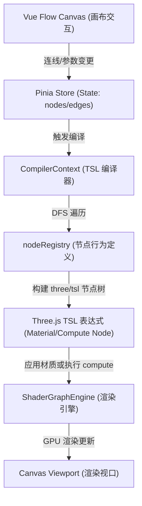
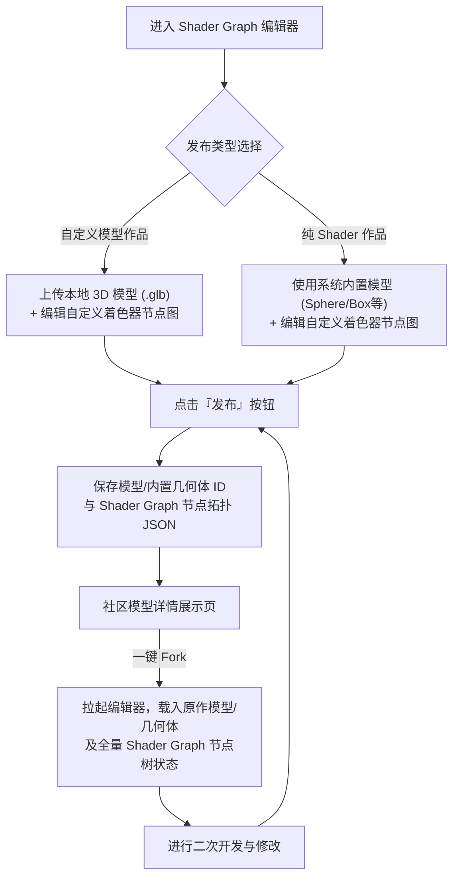
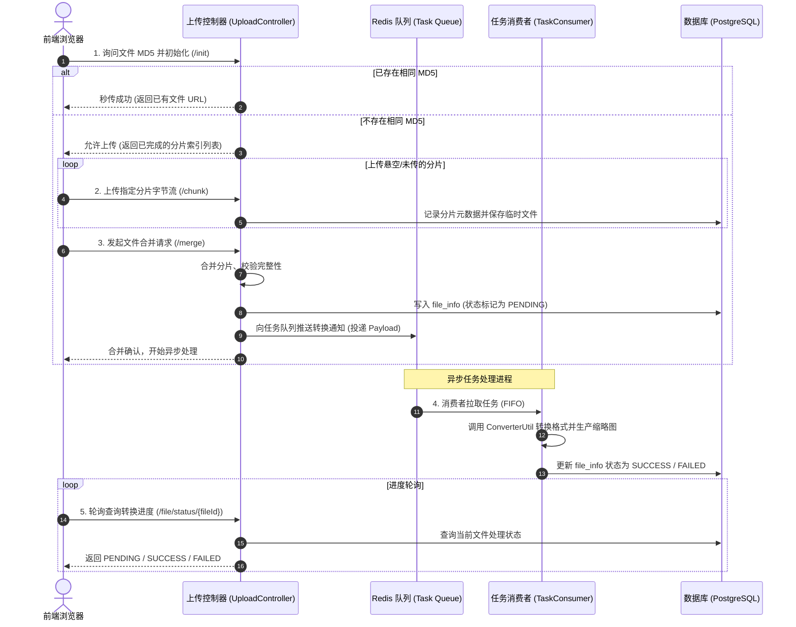

# 3D Model Sharing Platform

基于 Vue 3, Three.js (r184), Vue Flow, Spring Boot 和 FastAPI 的现代化 3D 模型分享、交互与 AI 检索社区。

[](https://vuejs.org/)
[](https://threejs.org/)
[](https://vueflow.dev/)
[](https://spring.io/projects/spring-boot)
[](https://fastapi.tiangolo.com/)
[](https://www.postgresql.org/)
[](https://redis.io/)
[](https://tailwindcss.com/)
[](https://www.docker.com/)
[](LICENSE)

---

## 项目简介

本项目是一个全栈式的 3D 模型分享与交互平台。前端基于 Vue 3、Vite、Three.js 与 Vue Flow 构建，实现了高性能的 3D 模型在线交互渲染及可视化着色器编辑；主后端基于 Spring Boot 框架，搭配 MyBatis-Plus 与 PostgreSQL 数据库进行数据持久化，提供安全、稳定、响应迅速的 API 服务；AI 检索后端基于 FastAPI 与 pgvector 提供智能的 3D 模型向量相似度检索与 AI 辅助推荐。

项目已实现完整的功能闭环，支持容器化一键快速部署，适合作为 3D 网页端展示、模型社区或企业级三维资产管理系统的脚手架与参考范本。

---

## 核心特性

- **3D 实时渲染交互**
  - 基于 Three.js 的 GLB 模型动态加载与 OrbitControls 轨道相机控制。
  - 支持平移、旋转、缩放等平滑视口交互。
  - 内置完善的渲染异常捕获与加载提示机制，确保前端浏览的稳定性。

- **可视化着色器编辑器 (Shader Graph Editor)**
  - **基于 Three.js TSL 编译内核**：突破传统的 GLSL 字符串拼接，利用最新的 Three.js NodeMaterial 与 TSL (Three.js Shading Language) 体系进行结构化编译，支持原生 WebGL/WebGPU 渲染无缝切换。
  - **多模式混合渲染引擎**：支持经典网格材质模式 (Classic Material Mode) 与高性能 GPU 粒子物理模拟模式 (Particle Simulation Mode)。在粒子模式下可动态分配显存并运行 compute shader 进行粒子物理学计算。
  - **闭环发布与 Fork 创作工作流**：
    - **混合模型发布**：支持将自定义的 3D 模型 (.glb) 与其专属的 Shader Graph 材质连线拓扑一并打包发布。
    - **纯 Shader 作品发布**：即使没有自定义模型，也可选择系统内置几何体（球体、立方体、圆柱体等）作为载体，将精心调校 the Shader 效果作为纯 Shader 资产独立发布。
    - **协同创作 Fork 机制**：支持对社区中已发布的任何 Shader 作品进行一键 "Fork" 克隆，自动载入其原作的模型与节点图状态进行二次编辑，激发社区协同创作灵感。
  - **丰富的节点生态**：内置 Constant (常量)、Math (数学)、Vector (向量)、Geometry (几何)、Texture (纹理采样) 等核心节点，支持高度定制化的参数面板（拖拽数值、颜色选取、纹理上传）。
  - **卓越的编辑器交互体验**：集成 Vue Flow 画布，支持连线动态贝塞尔曲线采样与高亮、撤销/重做历史队列、键盘快捷键（复制粘贴/多选删除）、节点 Tab 搜索菜单及分栏视口大小平滑拉伸。

- **全功能互动社区 (基于 Redis 缓存层支撑高并发)**
  - 支持模型点赞、收藏，快速将感兴趣的模型收录至个人库。
  - **基于 Redis 缓存的高并发交互设计**：将点赞、收藏等高频动作接入 Redis 缓存层进行极速响应和写削峰，大幅度降低底层关系型数据库的 I/O 压力，提升社区高并发性能。
  - 优雅的二级嵌套评论系统（类似 Bilibili 风格），支持回复特定用户，强化社区交流深度。
  - 创作者关注机制，支持关注、取消关注，动态展示作者的粉丝数与获赞数据。

- **私信与消息通知中心**
  - 即时私信系统：支持用户之间发送私信、会话列表聚合展示以及历史记录平滑查询。
  - 动态通知中心：自动生成并聚合点赞、收藏、新评论及关注等互动消息，支持全局一键已读。

- **高安全级别认证体系**
  - 基于 JWT（JSON Web Token）的无状态身份认证机制，Token 自动进行本地化加密存储。
  - 支持基于邮箱验证码的账户注册与密码重置服务，保证用户信息安全。

- **多维度检索与排序**
  - 强大的模糊搜索接口，支持按模型名称、关键词、作者或描述进行全文匹配。
  - 支持按分类筛选以及按发布时间或热门程度（点赞数、收藏数）进行复合排序。

- **大文件分片、断点续传与安全分发系统**
  - **分片与断点续传**：支持对大体积三维文件进行分片上传（默认 5MB/片），网络中断后可自动断点续传，显著提升大文件上传稳定性。
  - **MD5 文件秒传**：前端计算文件 MD5 进行校验，若服务器已存在相同文件，直接引用已有 URL 实现秒传，无需重复上传。
  - **私有存储与预签名防刷**：文件物理存储默认设为私有权限，后端通过 HMAC 算法生成带时效性（默认 5 分钟）的预签名 URL 分发给前端加载，防刷防爬防盗链。
  - **Redis 异步转换工作流**：合并完成后自动投递至 Redis 任务队列，后台转换进程异步进行模型格式转换及缩略图生成，状态采用 `PENDING/SUCCESS/FAILED` 动态跟踪，前端轮询查询，避免阻塞上传请求。

---

## 项目目录结构

```text
3d-model-website/
├── frontend/             # 基于 Vue 3 + Three.js + Tailwind CSS 的前端工程
│   ├── src/
│   │   ├── views/
│   │   │   └── ShaderGraph.vue      # 编辑器主页面，处理路由生命周期、撤销提示与引擎挂载
│   │   ├── shader-graph/            # 编辑器 UI 交互与状态管理
│   │   │   ├── components/          # 画布 (GraphCanvas)、头部栏 (GraphHeader)、节点 (UniversalNode) 及输入组件
│   │   │   ├── composables/         # 交互 Hook 集合（连线 UX、画布缩放、键盘快捷键、节点检索）
│   │   │   ├── stores/
│   │   │   │   └── shaderGraph.js   # 节点图核心 Pinia Store (管理节点、边状态及画布配置)
│   │   │   └── utils/               # 拓扑计算、连线校验与序列化 IO 辅助工具
│   │   └── rendering/               # 3D 渲染与着色器编译器
│   │       ├── compiler.js          # TSL 编译器上下文 (遍历拓扑结构生成 Three.js 节点树)
│   │       ├── engine.js            # ShaderGraphEngine 渲染与 Compute 计算引擎
│   │       ├── nodeRegistry.js      # 节点注册表 (定义各类节点的插槽、属性及编译为 TSL 的行为)
│   │       ├── registryUtils.js     # 寄存辅助函数 (类型定义、默认纹理与插槽回退处理)
│   │       └── utils.js             # 垃圾回收与资源销毁辅助函数
├── backend/              # 基于 Spring Boot + MyBatis-Plus + PostgreSQL 的后端工程
├── llm_backend/          # 基于 Fastapi + Pyvector的后端工程
├── docker-compose.yml    # 用于一键部署完整生产/演示环境的 Docker 配置文件
└── README.md             # 项目自述文件
```

---

## 着色器编辑器架构与业务工作流

项目内置的可视化着色器编辑器采用了 **数据驱动拓扑 -> 中间件编译 -> 动态渲染应用** 的解耦架构设计，并打通了社区分享和二次创作的链路。

### 1. 技术架构流向图

以下为着色器从节点编辑到最终模型上色渲染的完整数据流向：



### 2. 核心模块职责分工

- **前端视口容器** ([ShaderGraph.vue](frontend/src/views/ShaderGraph.vue))：作为页面入口，负责处理页面加载状态（从上传表单进入、或者是 Fork 别人作品进入）、渲染拆分比例的拉伸调整、以及离开页面时的脏检查 (Dirty Check) 防丢机制。
- **UI 画布与节点交互层**：
  - [GraphCanvas.vue](frontend/src/shader-graph/components/GraphCanvas.vue)：编辑器视图画布，核心集成 Vue Flow。负责管理画布视口缩放、节点及连线的渲染展示，并集中分发撤销重做、复制粘贴、删除以及拖拽连线等交互 Hook 行为。
  - [UniversalNode.vue](frontend/src/shader-graph/components/UniversalNode.vue)：自适应的通用节点外观渲染器。通过配置驱动，自动映射生成节点类型外观、输入/输出插槽布局并内置渲染参数微调面板（如颜色、拖拽数值输入等）。
- **状态管理** ([shaderGraph.js](frontend/src/shader-graph/stores/shaderGraph.js))：通过 Pinia 全局存储所有节点、连线数据，实现 Undo/Redo 历史命令模式，并持有渲染引擎的生命周期实例。
- **编译层**：
  - [compiler.js](frontend/src/rendering/compiler.js)：核心编译上下文。利用反向连线查找表，从最终的输出节点 (`mat-output` / `sim-output`) 开始，以**深度优先搜索 (DFS)** 溯源遍历上游依赖节点，避免死循环并实现缓存以减少重复构建。
  - [nodeRegistry.js](frontend/src/rendering/nodeRegistry.js)：每个节点在此处声明自身的输入输出 Socket、可调参数列表以及 `compile` 转换函数。转换函数最终调用 `three/tsl`（Three.js Shading Language）的 API 构建节点材质网络。
- **渲染层** ([engine.js](frontend/src/rendering/engine.js))：
  - 基于 `three/webgpu` 初始化 `WebGPURenderer`。
  - **材质上色 (Classic Mode)**：获取 TSL 树后，直接绑定到 `MeshStandardNodeMaterial` 的 `colorNode`、`roughnessNode`、`normalNode` 等插槽，调用 `needsUpdate = true` 触发 GPU 着色器自动重构。
  - **粒子计算 (Particle Mode)**：分配 GPU 粒子位置/速度缓冲区 (`StorageBufferNode`)。在顶点着色器中应用偏移，同时将物理公式的 TSL 树编译为 `tsl.compute` 模拟内核，在每帧渲染循环中调用 `renderer.compute(simulationKernel)` 实现完全跑在 GPU 上的粒子模拟。

### 3. 发布与 Fork 协同编辑工作流

编辑器与社区分享系统高度绑定，支持以下两种发布模式与 Fork 二次创作机制：



---

## 大文件上传与异步转换架构

系统针对大尺寸三维文件设计了“分片上传、断点续传、异步处理”的混合并发架构，在保证上传响应速度的同时，通过缓存拦截提供了良好的高并发访问抗压能力。

### 1. 业务工作流图 (Upload & Event Flow)



### 2. Redis 高并发架构应用职责

在本项目中，**Redis** 扮演了双重核心职责：
- **高频业务数据缓存与写削峰**：模型详情的点赞数、收藏状态等高吞吐交互数据优先落入 Redis 缓存（使用 Redis Set 结构实现 O(1) 判定）。用户点赞或取消点赞时，直接写入缓存并向 Redis 动作流水队列推送增量消息，后台异步同步至物理数据库，实现读写解耦，大幅提升高并发交互性能。
- **异步处理任务管道**：通过 Redis 链表（FIFO）实现轻量级任务消息队列，有效将耗时的三维模型几何转换（.glb 转预览、生产缩略图等）从 HTTP 请求中剥离，交由后台消费者线程池异步处理。

### 3. 私有安全签名访问链路

为保障模型资产版权安全性，系统采用了 **“私有存储 + 临时令牌授权”** 的防刷设计：
1. 文件在后台物理存储时默认设定为私有权限，外部无法通过常规静态路由直接请求。
2. 前端展示或加载模型时，向 `PresignedUrlController` 索要授权。
3. 后端 `PresignedUrlUtil` 结合配置文件私钥、文件路径与过期时间（默认 300 秒），计算出 HMAC-SHA256 签名串拼接在 URL 后部。
4. 资源服务（或 CDN）校验签名有效性，过期或签名篡改将直接拦截，从而有效拦截盗刷和恶意爬虫。

---

## 部署与开发指南

### 1. 使用 Docker Compose 一键部署（推荐）

项目支持通过 Docker 快速拉起整套运行环境（PostgreSQL 数据库、前端 Nginx、后端 Java 服务）。

```bash
# 克隆并进入项目根目录
cd 3d-model-website

# 复制环境变量模板并自定义配置
cp .env.example .env

# 一键启动所有服务
docker-compose up -d
```

启动完成后，您可以通过以下地址进行访问与调试：
- **前端门户**：`http://localhost:80`
- **后端 API 入口**：`http://localhost:8080`
- **PostgreSQL 数据库**：`127.0.0.1:5432` （用户名与密码读取自根目录 `.env`，默认为 `postgres` / `z3j1m4`）

---

### 2. 本地开发与调试

#### 前置要求
- **Node.js**：18.x 或以上版本
- **JDK**：17 或以上版本
- **Maven**：3.8.x 或以上版本
- **PostgreSQL**：14.x 或以上版本，启用pgvector拓展
- **Redis**：6.x 或以上版本（用于大文件转换异步队列与点赞/收藏高并发缓存）
- **uv**：管理Python 环境和依赖

#### 后端服务配置与启动

1. **准备基础中间件（PostgreSQL 与 Redis）**：
   - **方式一（推荐，全平台一键启动）**：使用项目自带配置仅启动中间件容器（自带 pgvector 扩展及端口映射）：
     ```bash
     docker compose up -d postgres redis
     ```
   - **方式二（本地原生安装运行）**：
     - **PostgreSQL**：登录本地实例，创建数据库：
       ```sql
       CREATE DATABASE threed_model_db;
       ```
     - **Redis**：启动 Redis 服务（默认监听 `6379` 端口）：
       - **macOS**：`brew services start redis`
       - **Linux**：`sudo systemctl start redis-server`
       - **Windows**：官方无原生包，建议执行 `docker run -d --name redis -p 6379:6379 redis:7.0-alpine`

2. **配置环境变量**：进入 `backend` 目录，将 `.env.example` 复制并命名为 `.env`，并在其中填入您本地 PostgreSQL 与 Redis 实际的连接信息（密码等）。
3. **运行后端服务**（系统将自动通过 `spring-dotenv` 加载您配置的 `backend/.env`）：
   ```bash
   cd backend
   mvn spring-boot:run
   ```

#### 前端工程配置与启动

1. 进入前端工程目录：
   ```bash
   cd frontend
   ```
2. 安装项目依赖：
   ```bash
   npm install
   ```
3. 启动开发服务器（支持热重载）：
   ```bash
   npm run dev
   ```
   运行成功后，浏览器访问 `http://localhost:5173`。前端已配置 Vite 反向代理，请求将自动转发至后端的 `http://localhost:8080`。

#### AI 后端配置与启动

1. 进入 AI 后端目录并同步依赖：
   ```bash
   cd llm_backend
   uv sync
   ```
2. 配置环境变量：将 `.env.example` 复制并命名为 `.env`，并在其中填入您实际的连接信息（密码等）。
3. 启动 FastAPI 服务：
   ```bash
   uv run uvicorn main:app --reload --host 127.0.0.1 --port 8000
   ```

